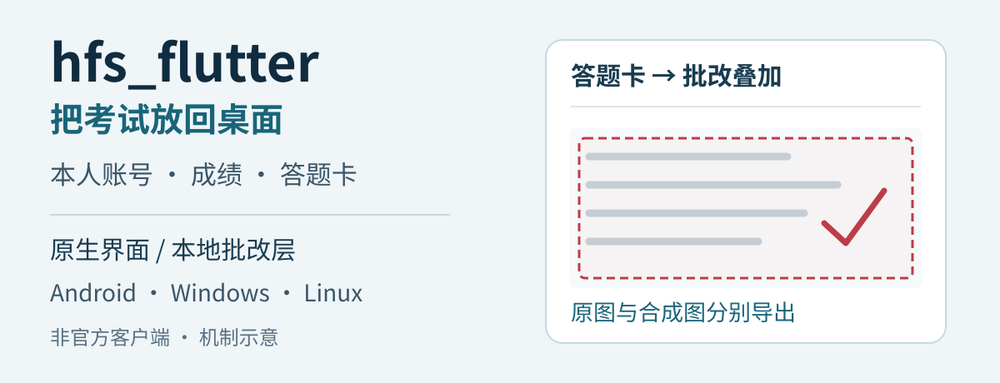
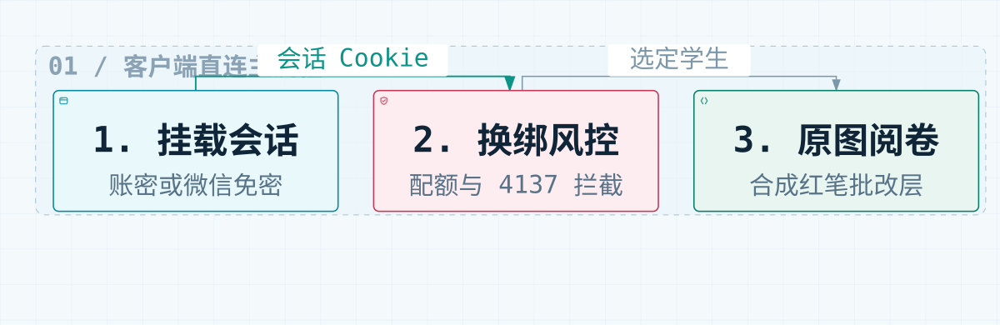
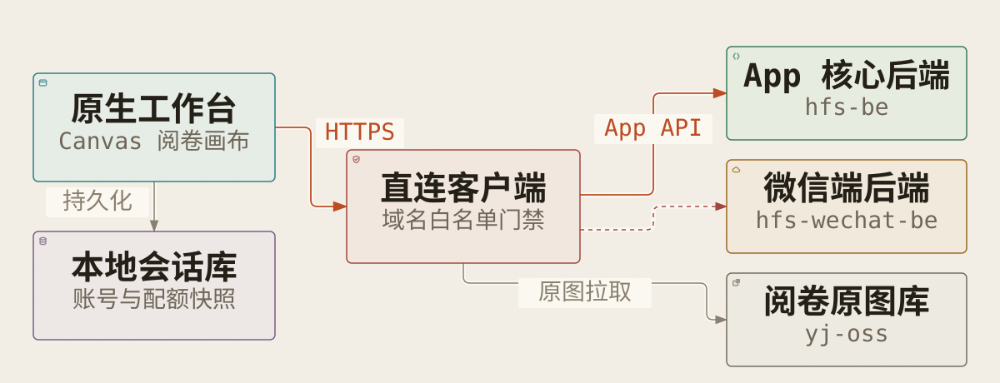

# hfs_flutter — 好分数原生直连工作台

`hfs_flutter` 是基于 Flutter 与 **Taste-Skill 2.5** 构建的好分数（Haofenshu）跨平台客户端（支持 **Android ARM64**、**Windows x64 Inno Setup** 与 **Linux x64**）。全量界面采用原生 Widget 与 Canvas 渲染（零 `WebView`），网络层内置官方域名白名单门禁，仅直连好分数三大官方 HTTPS 端点。

<p align="center">
  
</p>

## 快速开始与验证

直接安装预编译发行版（[GitHub Releases `v2.6.4`](https://github.com/preauthn1/hfs-flutter/releases/tag/v2.6.4)），或在本地运行仓库内的五项核心契约测试（官方域名白名单、微信小程序协议模型、微信代理路由、动态配额公式与 `320px` 窄屏防遮挡回归）：

```bash
flutter pub get
flutter test test/widget_test.dart
```

执行后输出如下（全部通过）：

```text
00:00 +0: Only official Haofenshu hosts are allowed
00:00 +1: WeChat mini-program models preserve role and key literally
00:00 +2: WeChat proxy URI stays on the official host
00:00 +3: Dynamic quota formula min(6, count(-1) + 3) and changeBindTime lock
00:00 +4: Mobile and Desktop Taste-Skill layouts render without overflow
00:05 +5: All tests passed!
```

> [!IMPORTANT]
> **许可与合规**：本项目内置字体遵循 [SIL Open Font License 1.1](assets/fonts/LICENSE.txt)。客户端仅允许用户输入本人合法获取的账号密码或微信小程序 `wx.login()` 凭证，严禁猜测或伪造 `code`/`unionId`/`key`，不对第三方手机号发起关联探测。

## 为什么选择 `hfs_flutter`（方案差异与取舍）

| 对比维度 | 传统网页中转 / WebView 壳 | 官方手机 App / 微信小程序 | `hfs_flutter` 原生工作台 |
| --- | --- | --- | --- |
| **网络链路** | 依赖第三方服务端反代或中转 | 仅限移动端单会话 | **`assertAllowedHost` 强校验，仅直连三大官方 HTTPS 域名** |
| **渲染与依赖** | 内嵌浏览器引擎，内存占用高 | 移动端原生 / 小程序容器 | **100% Flutter Widget + Canvas 渲染，仅 4 个纯 Dart 运行时依赖** |
| **多账号与备份** | 会话绑定在远端服务器 | 单账号切换繁琐 | **多家长端/学生端账号并行挂载，支持本地 `.json` 凭证导出与恢复** |
| **换绑风控保护** | 无前端配额核算，易触发 `4137` 丢源 | 无 `-1` 历史名额缩容预警 | **实时核算 $\min(6, \text{count}(-1)+3)$，自动拦截 `4137` 删源风险** |
| **答题卡导出** | 仅能保存未批改底图或网页截图 | 无法在桌面端批量无损导出 | **解析 `@c_` 裁切坐标，一键导出或复制红笔批改合成图 / 纯原图 (`.png`)** |

**明确适用边界**：
- 本客户端**不包含**任何服务端代挂、验证码自动识别或短信绕过逻辑；触发 `4048` 图形验证码或短信校验时，均由用户在原生界面手动完成。
- 不支持 iOS / Web 端打包分发，当前仅维护 **Android (`arm64`)**、**Windows (`x64`)** 与 **Linux (`x64`)** 三端。

## 主工作流

<p align="center">
  
</p>

从挂载账号到调阅试卷共分三步：首先通过账号密码（`POST /v2/users/sessions`）或微信小程序（`/v2/mini/account-login`）换取 `hfs-session-id` 会话；接着拉取已绑定学生列表并核算 `-1` 活名额与 180 天学期锁，在直绑或换绑前拦截高危目标；最后并发拉取考试总览、单科试卷与 OSS 原图，在本地 Canvas 合成红笔批改层。

### 1. 账号挂载与微信小程序直连 (`/v2/mini/*`)

支持家长端（`roleType = 2`）与学生端（`roleType = 1`）双角色，除常规账密登录、短信注册与密码重置外，完整对接微信小程序官方接口：

- `GET https://hfs-wechat-be.yunxiao.com/v2/mini/account-related-user`：使用本人 `wx.login()` 获得的 `code` 或 `unionId` 查询关联账号与一次性登录 `key`（发现态数据标记为 `transient`，绝不落盘）。
- `POST https://hfs-wechat-be.yunxiao.com/v2/mini/account-login`：使用 `key` 换取正式 JWT 并写入 `hfs-session-id`，后续自动复用同班名册、成绩与换绑能力。
- `POST https://hfs-wechat-be.yunxiao.com/v2/mini/account-register`：使用本人手机号、短信验证码与 `unionId` 完成注册。
- `POST https://hfs-wechat-be.yunxiao.com/v2/mini/account-logout`：在本地移除小程序来源账号时，自动同步注销上游小程序会话。
- `GET https://hfs-wechat-be.yunxiao.com/v1/be-proxy/v2/*` & `/v3/*`：支持通过微信侧官方代理网关读取最近考试快照、总分、班排、年级排及分科成绩。

### 2. 动态配额公式与换绑安全门禁

针对好分数绑定机制与历史名额规则，`lib/hfs_models.dart` 与 `lib/taste_widgets.dart` 内置完整的配额计算与风控拦截：

- **4 种检索与直绑通道**：支持 `姓名 + 学号/考号`、`学校 + 年级 + 姓名`（内置省/市/区三级学校检索）、`studentId` 直接输入、以及 `好分数绑定码`。
- **动态配额上限**：按 `estimatedMaxQuota = min(6, count(changeBindTime == -1) + 3)` 实时计算账号总容量与剩余可新增槽位（避免盲目请求触发 `4010` / `4025`）。
- **180 天学期锁识别**：自动解析 `changeBindTime` 解锁时间戳并标记锁定状态。
- **`-1` 活名额永久缩容预警**：当替换 `changeBindTime == -1` 的历史随时可换名额时，弹窗明确提示换绑后新记录将写入 `+180` 天锁，且本账号总容量上限将永久减 `1`。
- **`4137` 删源不加目标高危拦截**：好分数上游 `PATCH /v2/native-users/bind-student` 存在非原子写缺陷——当目标同学已激活学生端账号（`bindStudent` 非空）时，上游返回 `4137 Duplicate links` 却会将源学生直接移除。同班名册（`ClassmateRosterDialog`）与换绑弹窗会自动识别此类目标并弹出红色高危拦截框。

### 3. 原生答题卡批改叠加层与双端防遮挡布局

- **Canvas 矢量批改层 (`lib/answer_sheet_painter.dart`)**：自动解析题目图片 URL 中的 `@c_...,x_(\d+),y_(\d+),w_(\d+),h_(\d+)` 裁切坐标，在整张答题卡原图上按真实比例绘制红笔批改框、题号标签、得分胶囊与扣分标记；支持双指缩放、全屏灯箱（`←` / `→` 方向键切图）及一键导出含批改层或纯原图 `.png`。
- **移动端底部功能栏安全避让 (`v2.6.4`)**：手机端（宽度 `< 860px`）采用 `62px` 底部 `NavigationBar`。所有弹窗与右键/长按菜单通过 `Taste.dialogInsetPadding` 强制预留底部 `78px` 空间，并采用**固定顶部栏 + 可滚动内容区 + 独立不透明底栏 (`Taste.buildDialogFooter`)**，确保弹窗绝不遮挡底部功能栏，右下角“取消”按钮拥有 `>= 80×38` 的独立无重叠点击热区。

## 安装与跨平台构建

### 下载预编译安装包（推荐）

从 [GitHub Releases (`v2.6.4`)](https://github.com/preauthn1/hfs-flutter/releases/tag/v2.6.4) 下载对应平台产物，并通过 `SHA256SUMS.txt` 校验完整性：

| 平台 | 发行资产 | 说明 |
| --- | --- | --- |
| **Android (`arm64`)** | [`hfs_flutter_android_arm64.apk`](https://github.com/preauthn1/hfs-flutter/releases/download/v2.6.4/hfs_flutter_android_arm64.apk) | 正式签名包（证书 SHA-256：`b3227391...0169d346`） |
| **Windows (`x64` 安装版)** | [`hfs_flutter_windows_x64_setup.exe`](https://github.com/preauthn1/hfs-flutter/releases/download/v2.6.4/hfs_flutter_windows_x64_setup.exe) | 基于 `windows/installer.iss` 构建的 Inno Setup 向导安装包 |
| **Windows (`x64` 便携版)** | [`hfs_flutter_windows_x64.zip`](https://github.com/preauthn1/hfs-flutter/releases/download/v2.6.4/hfs_flutter_windows_x64.zip) | 免安装解压即用压缩包 |
| **Linux (`x64` 桌面版)** | [`hfs_flutter_linux_x64.tar.gz`](https://github.com/preauthn1/hfs-flutter/releases/download/v2.6.4/hfs_flutter_linux_x64.tar.gz) | GTK3 原生桌面端 Bundle |

### 从源码构建

**环境前提**：Flutter Stable `>= 3.24`（CI 固定使用 `3.47.7`），Dart SDK `>= 3.6.0 < 4.0.0`。

```bash
# 1. 拉取依赖并执行静态分析与测试
flutter pub get
dart format --output=none --set-exit-if-changed lib/ test/
flutter analyze --no-pub
flutter test test/widget_test.dart

# 2. 构建 Linux x64 桌面端（需安装 clang, cmake, ninja-build, pkg-config, libgtk-3-dev, liblzma-dev）
flutter config --enable-linux-desktop
flutter build linux --release

# 3. 构建 Windows x64 与 Inno Setup 安装包（在 Windows PowerShell 下执行）
flutter config --enable-windows-desktop
flutter build windows --release
iscc windows\installer.iss

# 4. 构建 Android ARM64 正式签名包（需配置 android/key.properties 或 ANDROID_KEYSTORE_* 环境变量）
flutter build apk --release --target-platform android-arm64
```

> [!NOTE]
> `android/app/build.gradle.kts` 已开启正式签名强校验：未提供正式签名密钥时，`release` 构建会直接拒绝打包，防止意外回退到 debug keystore。

## 架构与代码边界

<p align="center">
  
</p>

如上图所示，界面层（`lib/main.dart`、`lib/taste_widgets.dart`、`lib/answer_sheet_painter.dart`）与本地存储层（`SharedPreferences` 及 `.json` 凭证导入导出）不直接发起外部网络调用；所有 HTTP 流量均收口至 `HfsUpstreamClient`（`lib/hfs_client.dart`），经 `assertAllowedHost(Uri)` 校验后仅发往 `hfs-be.yunxiao.com`、`hfs-wechat-be.yunxiao.com` 与 `yj-oss.yunxiao.com`。

```text
hfs-flutter/
├── lib/
│   ├── main.dart                  # 响应式双端主框架、成绩看板、错题本、答题卡阅卷抽屉
│   ├── taste_widgets.dart         # Taste-Skill 2.5 组件库、登录/注册、绑定/换绑风控、同班名册、设置诊断弹窗
│   ├── answer_sheet_painter.dart  # 答题卡原图加载、Canvas 红笔批改合成、全屏灯箱、PNG 导出与剪贴板
│   ├── hfs_client.dart            # 官方域白名单门禁、App API、/v2/mini/* 微信接口与并发快照拉取
│   ├── hfs_models.dart            # 账号/学生模型、min(6, count(-1)+3) 配额计算与 JSON 序列化
│   └── win32_native.dart          # Windows 原生剪贴板位图写入与文件另存为对话框
├── readme/assets/                 # 经源码引用核验的静态 SVG 头图、流程图与架构图
├── test/
│   └── widget_test.dart           # 域名门禁、微信模型、动态配额与 320px 窄屏弹窗避让回归测试
├── windows/installer.iss          # Windows Inno Setup 安装程序脚本
└── .github/workflows/             # Android / Windows / Linux 自动构建与证书指纹校验流水线
```

## 状态与版本边界

- **当前状态**：活跃维护中，最新稳定版本为 **`v2.6.4`（build `13`）**，GitHub Actions 三端构建与 `apksigner` 证书 SHA-256 指纹核验全部通过。
- **升级兼容性**：`v2.6.4` 完全兼容 `v2.6.x` 本地 `SharedPreferences` 会话与导出的 `.json` 凭证备份文件，覆盖安装无需重新登录或重新绑定学生。

## 许可证

仓库内打包的中文字体（`NotoSansSC`）采用 [SIL Open Font License 1.1](assets/fonts/LICENSE.txt) 授权。
